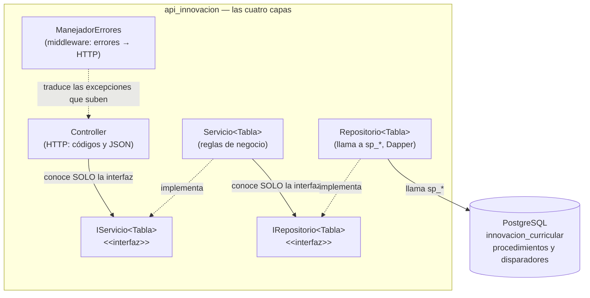

# Constitución del proyecto

> **Documento permanente.** Estas reglas rigen TODAS las versiones del
> módulo de innovación curricular. Cada versión tiene además su propia
> especificación en [versiones/](versiones/); ante conflicto, la
> constitución gana. Los cambios a este documento se registran en
> "Enmiendas" (al final), con fecha y motivo.

---

## Artículo 1 — El proyecto es POR VERSIONES y la especificación manda

- El sistema se construye por **versiones incrementales** (v1, v2, …), cada
  una con su spec kit propio (documentos 2 a 9). Una versión está TERMINADA
  solo cuando pasa sus criterios de aceptación y la regresión de las
  anteriores; entonces se hace commit, se sube al repositorio, se pone el tag
  `vN`, y solo después se escribe la spec de la siguiente.
- **No se anticipa** (**YAGNI** — "no lo vas a necesitar"): nada de
  autenticación, roles, dashboard ni consultas multitabla antes de la versión
  que los pida; ni las tablas de una versión posterior (el mapa de
  [versiones/0_mapa_versiones.md](versiones/0_mapa_versiones.md) dice qué
  tablas son de cuál). El código de cada versión solo puede nombrar lo que su
  spec nombra.
- El repositorio siempre contiene la **versión en curso, funcionando**.

## Artículo 2 — Stack: C# y ASP.NET Core; el SQL vive en la base

- Lenguaje **C#** sobre **ASP.NET Core** (.NET 10): controladores con
  atributos, inyección de dependencias del framework, `async/await` en
  todo el acceso a datos.
- **SIN ORM de entidades** (sin Entity Framework). Desde la v2, **todo el
  SQL vive en procedimientos almacenados** versionados en `db/`
  (`sp_listar_`, `sp_consultar_`, `sp_crear_`, `sp_actualizar_`,
  `sp_eliminar_` + tabla). El repositorio **solo los llama**, con
  parámetros (`@parametro`); nunca contiene SQL escrito a mano ni armado
  concatenando texto. El ejecutor es **Dapper**: mapea fila→objeto pero
  JAMÁS genera SQL por nosotros.
- Frontend en **ASP.NET Core Razor Pages** — mismo lenguaje, sin
  introducir un segundo ecosistema (Node/npm) mientras ninguna spec lo
  pida.
- Paquetes externos permitidos (y ninguno más sin que una spec lo pida):
  `Npgsql`, `Dapper`, `Swashbuckle.AspNetCore`.

## Artículo 3 — Arquitectura en capas con interfaces, desde el día 1

```
HTTP → Controller (valida el body contra la PETICIÓN del verbo → 400)
     → IServicio{Tabla}      (interfaz — reglas de negocio)
     → IRepositorio{Tabla}   (interfaz — el servicio no sabe cómo se guarda)
     → Repositorio{Tabla}    (Dapper, solo LLAMA a procedimientos sp_*)
     → la base de datos      (procedimientos y disparadores)
```

- El controlador no toca SQL; el servicio no conoce HTTP; el repositorio
  no conoce HTTP ni reglas de negocio.
- **Solo el ensamblador** (`Program.cs`) conoce clases concretas — todo
  lo demás recibe interfaces por constructor.
- El negocio comunica problemas con excepciones (`ConflictoExcepcion` →
  409 · `NoEncontradoExcepcion` → 404). La traducción a HTTP, incluida la de
  los errores de PostgreSQL (llave foránea `23503`, llave repetida `23505`),
  la hace **un solo middleware** (`ManejadorErrores`): ni el controlador ni el
  servicio conocen códigos de la base.



Cajas = quién; flecha continua = «conoce y usa»; punteada = «implementa» o
«traduce». El SQL vive solo a la derecha, en la base.

## Artículo 4 — Un solo comando

`docker compose up -d --build` deja TODO el sistema de la versión en
curso funcionando: base de datos, API y frontend juntos. El código va
montado como volumen y corre con `dotnet watch`. **Requisito previo:** copiar
`.env.example` a `.env` y poner los valores propios (Artículo 8).

## Artículo 5 — La base de datos viene DADA

La BD `innovacion_curricular` la entrega el profesor en
`db/00_innovacion_curricular.pg.sql` (25 tablas) — se copia tal cual, no
se edita. Lo que una versión necesite y el script no traiga (como la
columna `activo`, los procedimientos o los disparadores) se agrega en un
script **adicional y numerado** dentro de `db/` (`01_alter_activo.sql`,
`02_…`), nunca tocando el original.

## Artículo 6 — Todo en español, comentado con el POR QUÉ

Nombres, rutas, mensajes, comentarios y documentación: **en español**. Los
comentarios dicen **por qué** se tomó una decisión, no **qué** hace la línea:
un comentario que solo repite el nombre del método no cuenta. Prueba de fuego:
si se tapa el código y el comentario sigue diciendo algo, sirve. El repositorio
es también material de estudio del equipo, y cada integrante tiene que poder
explicar en voz alta lo que entregó.

## Artículo 7 — Contratos exactos

Los endpoints, formatos y códigos de estado de cada versión están en su
`6_contracts.md` y se cumplen al pie de la letra. En las versiones v1 y v2
solo existe `PUT` (reemplazo completo, sin la llave primaria) — no se
implementa `PATCH`, porque ninguna spec lo pidió (Artículo 1).

## Artículo 8 — Convenciones fijas

| Cosa | Convención |
|---|---|
| Puertos | API **8080** · Frontend **8081** · PostgreSQL **15432** (mapeado del 5432 interno, para no chocar con un PostgreSQL local) |
| Rutas | `/` (diagnóstico) · `/swagger` (documentación interactiva) · `/api/{tabla}` (recurso REST) |
| Nombres | PascalCase en español; interfaces con prefijo `I`; carpetas `Controllers/ Modelos/ Peticiones/ Servicios/ Repositorios/ Excepciones/ Middleware/` |
| Sobre de respuesta | Lecturas: arreglo JSON directo · Errores de negocio: `{ "mensaje": "..." }` · Errores de validación del body: `ValidationProblemDetails` estándar de ASP.NET Core |
| Errores | Body inválido → **400** · llave repetida, llave foránea inexistente o regla de negocio violada (p. ej. retirar un maestro con detalle activo) → **409** con mensaje en castellano · `NoEncontradoExcepcion` → **404** · error no previsto → **500**. Un 500 donde correspondía un 409 es un criterio fallado |
| Llaves primarias | Las fija `5_data_model.md` de cada versión según el script dado: `INT` sin autoincremento (el id/nit lo envía quien crea el registro), llaves de texto, o **compuestas** en las tablas puente. Excepción: `usuario`, `rol`, `rol_usuario`, que sí son `SERIAL` |
| Secretos | Cadena de conexión, contraseña de la BD y cualquier clave van en **variables de entorno** (`.env`, que **nunca** se sube a git y está en `.gitignore` desde el primer commit). El repositorio incluye `.env.example` con valores de mentira. Un secreto escrito en el código o en un archivo versionado anula el criterio de seguridad de la versión |
| Base | `innovacion_curricular` (la entrega el profesor; Artículo 5) |

---

## Enmiendas

| Fecha | Artículos | Qué cambia | Motivo |
|---|---|---|---|
| 2026-10-15 | 1 | «Entregas» pasa a «versiones»; la prohibición de anticipar se redacta por contenido y por mapa de versiones, no por «tablas con FK» | La v2 es justamente la que pide las tablas con FK; la metodología habla de versiones (`0_METODOLOGIA.md` §2) |
| 2026-10-15 | 2 | El SQL deja de escribirse a mano en C#: vive en procedimientos almacenados en `db/` y el repositorio solo los llama | `VERSION_2.md` §4 y criterio 3: los cinco verbos de todas las tablas pasan por procedimientos |
| 2026-10-15 | 3 | `ConflictoExcepcion` pasa de 400 a 409; se agrega el middleware `ManejadorErrores` que traduce errores de PostgreSQL | `VERSION_2.md` §7: la integridad referencial responde 409, nunca 500 |
| 2026-10-15 | 4, 5 | Se agrega el requisito de `.env`; los scripts de `db/` pueden traer procedimientos y disparadores | Secretos fuera del código (metodología §6); `VERSION_2.md` §4–§5 |
| 2026-10-15 | 6 | Los comentarios pasan de «para principiantes» a «dicen el porqué» | Interpretabilidad (metodología §2.2) |
| 2026-10-15 | 7 | Se precisa que no hay `PATCH` en v1 y v2 | Decisión B4 de `v2_tablas_con_fk/2_spec.md` |
| 2026-10-15 | 8 | Errores: duplicado y FK pasan a 409; llaves por tabla en `5_data_model.md`; las credenciales didácticas salen del artículo y se exigen variables de entorno | Decisión B3 de la spec v2; metodología §6 |

**Efecto sobre la v1 (ya cerrada, tag `v1`).** La v1 no se reabre. Sus
criterios que decían «400» para llave repetida se corren en la regresión de la
v2 con **409**; la decisión queda registrada en `4_research.md` de la v2. La
contraseña que la v1 dejó en `docker-compose.yml` se considera expuesta en el
historial: la v2 la **cambia** (rotación) y la saca a `.env`.
