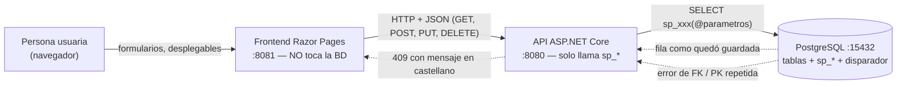

# 2_spec.md — Versión 2: tablas con llave foránea, procedimientos y disparador

> Rige junto con [1_constitution.md](../../1_constitution.md). Describe
> **solo el delta** respecto a la v1. Fuente de los requisitos:
> `VERSION_2.md` del profesor. Ante conflicto, la constitución gana (y esta
> versión propone enmiendas a ella; ver "Decisiones abiertas").

## Propósito

Dejar **las 22 tablas propias del módulo operables desde la interfaz**
(las de control de acceso son de la v3), con todo el CRUD pasando por
procedimientos almacenados, al menos un disparador funcionando, ninguna
llave foránea digitada a mano y los criterios de la v1 todavía en verde.

## Diagrama de contexto

Cajas = quién; flechas continuas = lo que se pide; punteadas = lo que
vuelve. El SQL vive solo en la base (derecha); la API solo lo llama y
traduce los errores de la base a códigos HTTP.

## Alcance

**Incluye:**

| Bloque | Qué se hace |
|---|---|
| 15 tablas nuevas | 7 entidades con FK: `facultad`, `programa`, `acreditacion`, `registro_calificado`, `activ_academica`, `pasantia`, `premio`. 8 tablas puente/compuestas: `programa_ac`, `programa_pe`, `programa_ci`, `an_programa`, `enfoque_rc`, `aa_rc`, `docente_departamento`, `alianza` |
| Migración de la v1 | Las 7 tablas de la v1 pasan **también** a procedimientos almacenados (el criterio 3 exige los 5 verbos de **todas** las tablas); su repositorio deja de tener SQL escrito a mano |
| Procedimientos | `sp_listar_`, `sp_consultar_`, `sp_crear_`, `sp_actualizar_`, `sp_eliminar_` + `<tabla>`; devuelven la fila **como quedó guardada**; los listados filtran `activo` |
| Disparador | Al menos uno, versionado en el script de la base y comprobable por la interfaz |
| Maestro-detalle | En la interfaz, al abrir el maestro se ve su detalle ahí mismo y se le agregan renglones sin salir; varios renglones viajan en **un solo envío** (transacción) |
| Desplegables | Toda FK se elige de un `<select>` cargado desde la API (muestra nombre, manda llave); FK opcional con «(ninguna)» → `null` |
| Integridad | FK inexistente, pareja repetida → **409** en castellano; nunca 500 |
| Datos de referencia | Script `db/06_datos_referencia.sql` con las áreas, universidades, facultades y programas del Excel del profesor, y la ampliación de `area_conocimiento.disciplina` y `programa.nombre` para que quepan (D-v2-12) |
| Regresión v1 | Los criterios de la v1 se corren completos el día de la entrega |
| Entregables | Script de BD con procedimientos y disparador, colección de pruebas (incluye las que deben fallar), prompts con las correcciones, guía de IA de la versión, tag `v2` |

**Relaciones maestro-detalle de este módulo** (VERSION_2.md §3):

| Maestro | Detalle |
|---|---|
| `universidad` | `facultad` |
| `facultad` | `programa` |
| `programa` | `acreditacion`, `activ_academica`, `pasantia`, `premio`, `registro_calificado` |

**NO incluye:**

| Excluido | Va en |
|---|---|
| Login, contraseñas, tokens, permisos por rol; CRUD de `usuario`, `rol`, `rol_usuario` | v3 |
| Consultas multitabla, dashboard con gráficos, imagen corporativa, publicación | v4 |
| Validación real de `docente` (tabla de otro módulo; `docente_departamento.docente` y `alianza.docente` quedan `INT` sin FK) | fuera del módulo |

## Requisitos funcionales

| # | Requisito |
|---|---|
| RF1 | Cada verbo de las 22 tablas pasa por `sp_*` (5 verbos en 17 tablas; 4 en los 5 puentes de solo llaves, que no se editan, RF6); el repositorio solo **llama** al procedimiento con parámetros. La única sentencia permitida en C# es la llamada `SELECT * FROM sp_xxx(...)`; ningún `SELECT`/`INSERT`/`UPDATE`/`DELETE` sobre tablas. |
| RF2 | Tablas con `activo`: `sp_eliminar_*` hace `UPDATE … SET activo = false` (la columna es booleana en el esquema dado) y todo listado filtra inactivos. |
| RF3 | `sp_crear_*` y `sp_actualizar_*` devuelven la fila como quedó guardada (valores por defecto y cálculos del disparador incluidos). |
| RF4 | Crear un hijo cuyo padre no existe (o está inactivo) → **409** con mensaje que nombra el campo. |
| RF5 | Repetir una pareja **activa** en una tabla puente, o cualquier llave primaria ya existente → **409**; una pareja retirada se reactiva (B6) y responde 201. |
| RF6 | Tablas puente: se **asignan** y se **retiran** con sus dos llaves; **no** tienen botón ni verbo de editar cuando solo contienen llaves. Las que tienen campos propios (`aa_rc`, `docente_departamento`, `alianza`) sí se actualizan. |
| RF7 | Un detalle no existe sin su maestro: la interfaz lo crea desde la pantalla del maestro, con el maestro ya fijado. |
| RF8 | Varios renglones de detalle se registran en **una sola petición** y **una sola transacción**: si falla uno, no se guarda ninguno. |
| RF9 | Los desplegables solo ofrecen padres **activos**; la FK opcional (`activ_academica.disenio`) acepta «(ninguna)» → `null`, nunca cadena vacía. |
| RF10 | Disparador: el dato derivado cambia **sin que la API lo envíe**, y escucha `INSERT`, `UPDATE` **y** `DELETE` (retirar es un `UPDATE`). |
| RF11 | La interfaz no muestra jerga («PUT», «PATCH», «422», «FK»). |
| RF12 | Regla de retiro lógico (B1): no se puede retirar un maestro con detalle activo → 409 «tiene registros activos». |
| RF13 | Secretos fuera del código: la cadena de conexión y la contraseña de la BD salen de variables de entorno; `.env` en `.gitignore` desde el primer commit y `.env.example` con valores de mentira (metodología §6; la v1 dejó la contraseña en el compose y se corrige aquí). |
| RF14 | Los comentarios del código nuevo dicen **por qué**, no qué (metodología §2.2); el comentario que repite el nombre del método no cuenta. |

## Criterios de aceptación (los 12 del profesor, aplicados al módulo)

| # | Criterio | Comprobación en este módulo |
|---|---|---|
| 1 | Tablas de la v1: CRUD + interfaz | Se abre cada una: crear, editar, retirar |
| 2 | Tablas de la v2: CRUD + interfaz | Las 15, una por una |
| 3 | Todos los verbos pasan por procedimientos (115 funciones `sp_*` en total, ver `7_quickstart.md` §2) | `grep` en los repositorios: ninguna línea con `SELECT`/`INSERT`/`UPDATE`/`DELETE` que no sea una llamada `FROM sp_` |
| 4 | Disparador funciona | Se agrega/retira un detalle por la interfaz y cambia el contador solo |
| 5 | Cada FK es un desplegable de la API | Lleno, con nombres (p. ej. facultad → nombre de universidad) |
| 6 | FK opcional acepta «(ninguna)» | Crear `activ_academica` sin `disenio` |
| 7 | Hijo con padre inexistente → 409 | Desde la colección de pruebas; un 500 es fallo |
| 8 | Puente: asignar, repetir (409), retirar | Con `programa_ac` y `aa_rc` |
| 9 | Detalle visible/agregable desde el maestro | Abrir un `programa`: aparecen acreditaciones, pasantías, premios… |
| 10 | Listados filtran lo retirado | Desaparece de la lista; sigue en la base con `activo = false` |
| 11 | Sin jerga en pantallas | Revisión visual |
| 12 | Regresión v1 completa | Se corren los criterios de `v1_catalogos_postgres/2_spec.md` |

## Clarificaciones (compuerta 1)

> Nada de esto se resuelve en el código: se decide aquí. La spec **no
> pasa a `3_plan.md`** mientras quede un `[NECESITA ACLARACIÓN]`.

| # | Pregunta | Propuesta | Estado |
|---|---|---|---|
| B1 | ¿Se puede retirar un maestro con detalle activo? (VERSION_2.md §7 pide que el equipo lo decida) | No: 409 «tiene registros activos» | **Resuelta:** no se retira un maestro con detalle activo → 409 «tiene registros activos» |
| B2 | Disparador a implementar (A contador, B sello, C bitácora, D validación, E estado derivado) | **A**: `facultad.total_programas`, recalculado con `INSERT`, `UPDATE` y `DELETE` sobre `programa` | **Resuelta:** disparador A, `facultad.total_programas` |
| B3 | La v1 devolvía **400** en duplicado; la v2 pide **409** (duplicado, FK) | Unificar en **409** y enmendar Art. 8 y criterios de la v1 para que la regresión siga en verde | **Resuelta:** todo duplicado/FK → 409, también en la v1 (se enmiendan Art. 8 y criterios de la v1) |
| B4 | Metodología §7 lista `PATCH` por tabla y los códigos 400/422; la v1 solo hizo `PUT` y 400 (Art. 7 y 8) | Documentar que `PATCH` no se implementa (YAGNI) salvo que el profesor lo exija; validación del body se queda en 400 | **Resuelta:** sin `PATCH`; validación del body sigue en 400 (a confirmar con el profesor si lo exige) |
| B5 | VERSION_2.md §12 habla de un sobre `{tabla, limite, total, datos}`; la v1 devuelve arreglo plano | Mantener arreglo plano (es nuestra API) | **Resuelta:** arreglo plano, sin sobre |
| B6 | Fila puente inactiva al repetir la pareja: ¿409 o reactivar? | Reactivarla | **Resuelta:** se reactiva la fila puente inactiva |
| B7 | Datos de referencia del Excel (218 áreas, 6 universidades, 35 facultades, 191 programas) | Script `db/0N_datos_referencia.sql` | **Resuelta:** script `db/06_datos_referencia.sql` desde `Base de Datos v6.xlsx`; ampliar dos columnas y rellenar con valores documentados las obligatorias que el Excel no trae (D-v2-12) |

## Historial de cambios

| Versión | Fecha | Cambio |
|---|---|---|
| 2.4 | 2026-10-16 | Compuerta 3: RF1 y criterio 3 cuentan 4 verbos en los 5 puentes de solo llaves (contradecían a RF6); RF5 distingue pareja activa de retirada (contradecía a B6) |
| 2.3 | 2026-10-16 | B7 detallada: origen de los datos, ampliación de dos columnas y valores de relleno (D-v2-12) |
| 2.2 | 2026-10-15 | Compuerta 1 cerrada: B1–B7 resueltas, sin `[NECESITA ACLARACIÓN]` pendientes |
| 2.1 | 2026-10-15 | Se agregan diagrama de contexto, compuerta 1 (clarificaciones), secretos (RF13) y comentarios (RF14) según 0_METODOLOGIA.md |
| 2.0 | 2026-10-15 | Spec de la v2 reescrita a partir de `VERSION_2.md` (borrador anterior descartado: asumía validar FK con 400, ignoraba procedimientos y disparador) |
