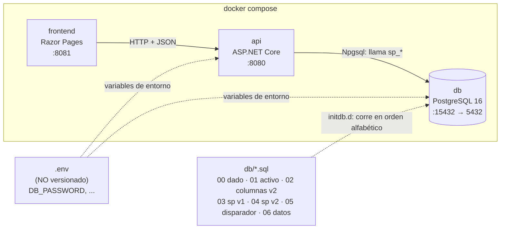
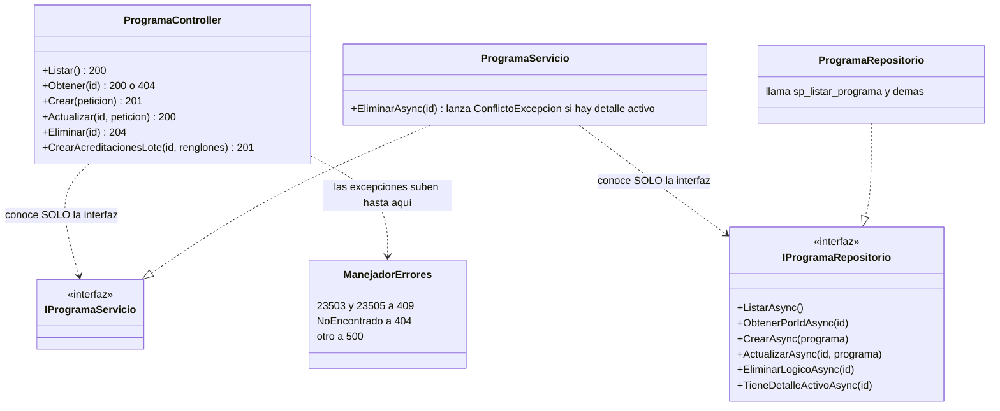
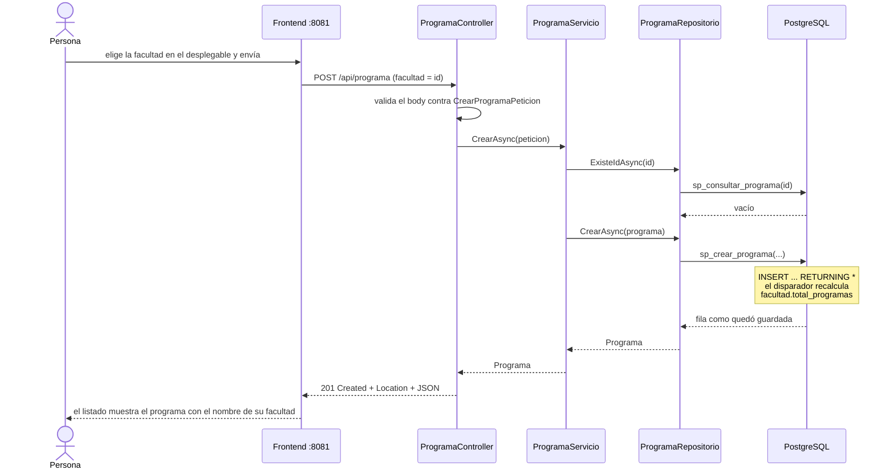

# 3_plan.md — Versión 2: tablas con llave foránea, procedimientos y disparador

> Aplica la constitución a la v2 y describe **solo el delta** respecto a
> [la v1](../v1_catalogos_postgres/3_plan.md). Requisitos: [2_spec.md](2_spec.md).

## Stack de esta versión

Igual que la v1 (C# / ASP.NET Core .NET 10, Dapper, Npgsql, Swashbuckle,
PostgreSQL 16, Razor Pages, Docker). **No entra ningún paquete nuevo.**

Lo que cambia es **dónde vive el SQL**:

| | v1 | v2 |
|---|---|---|
| SQL de las 22 tablas | texto dentro del repositorio C# | funciones `sp_*` dentro de PostgreSQL |
| Qué hace el repositorio | escribe y ejecuta SQL | **llama** a la función por su nombre, con parámetros |
| Dónde se versiona el SQL | en el código C# | en `db/*.sql`, numerado |

## Diagrama de despliegue



Cajas = contenedores del compose con sus puertos. El frontend **nunca** toca
la base. Los secretos entran por variables de entorno desde `.env`, que no se
sube a git (solo `.env.example`). Los scripts de `db/` se aplican solos al
crear el volumen, en orden numérico.

## Estructura de carpetas (solo lo nuevo o cambiado)

```
proyecto/
├── .env.example                          ← NUEVO: variables con valores de mentira
├── .gitignore                            ← CAMBIA: agrega .env
├── docker-compose.yml                    ← CAMBIA: lee ${DB_PASSWORD}, sin secretos
├── db/
│   ├── 02_alter_v2.sql                   ← NUEVO: facultad.total_programas + ampliar 2 columnas
│   ├── 03_sp_v1.sql                      ← NUEVO: 5 sp × 7 tablas de la v1
│   ├── 04_sp_v2.sql                      ← NUEVO: 5 sp × 15 tablas + lotes + conteos
│   ├── 05_disparadores.sql               ← NUEVO: trg_contar_programas
│   └── 06_datos_referencia.sql           ← NUEVO: datos del Excel del profesor
├── docs/spec_kit/versiones/v2_tablas_con_fk/   ← este spec kit + GUIA_IA2.md
├── pruebas/                              ← NUEVO: colección de pruebas (incluye las que fallan)
├── api_innovacion/
│   ├── Modelos/ Peticiones/ Controllers/ ← +15 de cada uno
│   ├── Servicios/ Repositorios/          ← +15 interfaces e implementaciones; los 7 de la v1 se reescriben
│   ├── Excepciones/                      ← ConflictoExcepcion pasa a 409; se agrega el traductor
│   └── Middleware/ManejadorErrores.cs    ← NUEVO: errores de PostgreSQL → HTTP
└── frontend_innovacion/
    ├── Servicios/   (+15 clientes HTTP)
    └── Pages/{Tabla}/                    ← +15 carpetas; Programa, Facultad y Universidad
                                             llevan además Detalle.cshtml (maestro-detalle)
```

## Diseño de capas (delta sobre la v1)

| Capa | Cambio en la v2 |
|---|---|
| Controller | Igual: traduce excepciones a HTTP. Se agregan rutas de **lote** para los maestros (`POST /api/programa/{id}/acreditaciones/lote`, etc.; el contrato exacto va en `6_contracts.md`). Las tablas puente usan la llave compuesta en la ruta. |
| Servicio | Aplica la regla B1: antes de retirar un maestro pregunta al repositorio si tiene detalle activo y lanza `ConflictoExcepcion` (409). |
| Repositorio | **Sin SQL sobre tablas.** Cada método ejecuta una sola sentencia: la llamada `SELECT * FROM sp_xxx(@p1, @p2)`, como texto y con parámetros (decisión D-v2-2: `CommandType.StoredProcedure` genera `CALL` desde Npgsql 7 y nuestros `sp_*` son funciones). |
| Base de datos | Funciones `sp_listar_`, `sp_consultar_`, `sp_crear_`, `sp_actualizar_`, `sp_eliminar_` + `<tabla>`; listados con `WHERE activo`; `RETURNING *`; el disparador. |
| Middleware | `ManejadorErrores` atrapa `PostgresException`: `23503` (FK) y `23505` (PK repetida) → **409** en castellano con el campo y el valor; cualquier otra → 500. |

Operaciones por familia de tabla:

| Familia | Tablas | Operaciones |
|---|---|---|
| Entidad con llave simple | las 7 de la v1 y las 7 con FK | los 5 verbos |
| Puente solo-llaves | `programa_ac`, `programa_pe`, `programa_ci`, `an_programa`, `enfoque_rc` | listar, consultar, **asignar** (crear), **retirar** (eliminar); sin actualizar |
| Puente con campos propios | `aa_rc`, `docente_departamento`, `alianza` | los 5 verbos |
| Lote del maestro | detalle de `universidad`, `facultad`, `programa` | `sp_crear_<detalle>_lote(p_maestro, p_renglones jsonb)`: un envío, una función = una transacción |

## Diagrama de clases (la rebanada `programa`; las demás son iguales)



Cajas = clases; `..>` = «conoce»; `..|>` = «implementa». El controlador y el
servicio solo ven interfaces; la clase concreta aparece únicamente en
`Program.cs`. El manejador es el único que sabe de códigos de PostgreSQL.

## Secuencia del camino feliz: crear un programa



Se lee de arriba abajo: cada flecha cruza **una** capa. La validación del
formato corta en el controlador (400); la regla de «ya existe» la decide el
servicio (409); el SQL y el disparador viven solo en la base. La fila que
vuelve ya trae el efecto del disparador.

## Orden de construcción (resumen; el detalle va en `8_tasks.md`)

1. Secretos: `.env`, `.env.example`, `docker-compose.yml`, `.gitignore`.
2. Base: scripts `02` a `06` aplicados y probados con `psql`, **antes** de tocar C#.
3. Manejador de errores 409 y migración de las 7 tablas de la v1 a `sp_*`, juntos, porque la regresión de la v1 ya espera 409; se corre la regresión.
4. Las 7 entidades con FK; después las 8 tablas puente.
5. Lotes del maestro-detalle.
6. Frontend: desplegables y pantallas de detalle.
7. Colección de pruebas, regresión completa, `GUIA_IA2.md`, tag `v2`.

---

## Chequeo de constitución (compuerta 2)

Artículo por artículo contra `1_constitution.md`:

| Art. | Dice | ¿Lo respeta este plan? | Qué hacer |
|---|---|---|---|
| 1 | Entregas incrementales; YAGNI: nada de tablas con FK antes de la entrega que las pida | **Sí**: la v2 es la que las pide. Pero el texto habla de «entregas» y de «Entrega 2» | **Enmienda de forma**: «entregas» pasa a «versiones» (mismo vocabulario de la metodología) |
| 2 | SQL **a mano, visible y parametrizado** en el código C#; paquetes permitidos: Npgsql, Dapper, Swashbuckle | **No** en el primer punto: ahora el SQL vive en procedimientos y C# solo los llama. El segundo punto sí se cumple (ningún paquete nuevo) | **Enmienda de fondo**: «SIN ORM; el SQL vive en procedimientos almacenados versionados en `db/`; el repositorio los llama con parámetros y no contiene SQL» |
| 3 | Capas con interfaces; `ConflictoExcepcion` → 400 | Las capas **sí**. El código **no**: ahora es 409 | **Enmienda**: `ConflictoExcepcion` → 409; el traductor de errores de PostgreSQL vive en el middleware, no en el controlador ni el servicio |
| 4 | Un solo comando levanta todo | **Sí**, con un requisito previo: copiar `.env.example` a `.env` | **Nota** en el artículo y en `7_quickstart.md` |
| 5 | BD dada; lo adicional va en scripts numerados | **Sí**: `02` a `06` son nuevos, no se toca el `00` | Ninguna |
| 6 | Todo en español, comentarios «para principiantes» | **Sí** en el idioma. **No** en el tipo de comentario: la metodología exige que digan **por qué**, no qué | **Enmienda**: los comentarios explican la razón de la decisión |
| 7 | Contratos exactos; solo `PUT`, sin `PATCH` | **Sí** (decisión B4); se suman los endpoints de lote en `6_contracts.md` | Ninguna |
| 8 | Puertos y rutas; errores 400 por duplicado; llaves `INT` sin autoincremento; **credenciales didácticas escritas en el artículo** | Puertos, rutas y sobre **sí**. Errores **no** (409). Llaves: hay tablas con llave compuesta y con llaves distintas de `INT`. Credenciales **no**: los secretos van en variables de entorno | **Enmienda**: duplicado y FK → 409; las llaves de cada tabla se fijan en `5_data_model.md`; las credenciales salen del artículo y de `docker-compose.yml` |

**Resultado:** el plan respeta el espíritu de la constitución, pero cuatro
artículos (2, 3, 6 y 8) necesitan **enmienda** y uno (1) un cambio de forma.
Las enmiendas se registran en la constitución con fecha y motivo, en el
mismo commit que cierra esta compuerta. Nada «se deja pasar por esta vez».

## Historial de cambios

| Versión | Fecha | Cambio |
|---|---|---|
| 2.0 | 2026-10-15 | Plan de la v2 (borrador para revisión) |
