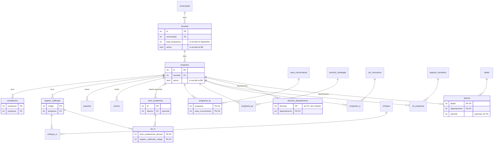

# 5_data_model.md — Versión 2: tablas con llave foránea

> Fuente única: `db/00_innovacion_curricular.pg.sql` (dado por el profesor,
> Artículo 5). Las 7 tablas de la v1 no cambian; aquí se describen las 15
> nuevas y cómo se relacionan con ellas. Todos los tipos y nulabilidades son
> los del script, sin tocar.

## Diagrama entidad-relación

Se lee así: cada línea es una llave foránea; `||` = «exactamente uno» y
`o{` = «cero o muchos». `docente` no tiene línea porque su tabla vive en otro
módulo. Solo se dibujan las columnas de llave y las que escribe la base; las
demás están en las tablas de abajo.

## Qué escribe la BASE, no la API

| Columna | Quién la escribe | Cómo |
|---|---|---|
| `activo` (22 tablas) | La base | `db/01_alter_activo.sql`: `BOOLEAN DEFAULT TRUE`; `sp_eliminar_*` la pasa a `false` |
| `facultad.total_programas` (nueva) | **El disparador** | `db/02_alter_v2.sql` la agrega (`INT NOT NULL DEFAULT 0`); `db/05_disparadores.sql` la mantiene. La API **nunca** la envía |
| Llaves primarias | Quien crea el registro | Ninguna es `SERIAL` (D1 de la v1) |

## Lo que la v2 cambia en tablas de la v1

| Tabla | Columna | Antes | Ahora | Motivo |
|---|---|---|---|---|
| `area_conocimiento` | `disciplina` | VARCHAR(60) | VARCHAR(130) | 19 disciplinas del Excel miden hasta 124 (D-v2-12) |
| `facultad` | `total_programas` | — | INT NOT NULL DEFAULT 0 | la mantiene el disparador |

## Las 15 tablas

Convenciones: `PK` llave primaria, `FK→` llave foránea, `NN` no nulo. Los tipos
`VARCHAR(n)` se envían como texto con ese máximo; en C# `INT`→`int`,
`DATE`→`DateOnly`, `VARCHAR`→`string`.

### `facultad`
| Columna | Tipo | Nulo | Nota |
|---|---|---|---|
| `id` | INT | NN | PK |
| `nombre` | VARCHAR(60) | NN | |
| `tipo` | VARCHAR(45) | NN | «Facultad», «Departamento» o «Instituto» |
| `fecha_fun` | DATE | NN | |
| `universidad` | INT | NN | FK→`universidad(id)` |
| `total_programas` | INT | NN | **agregada**; solo la escribe el disparador |

### `programa`
| Columna | Tipo | Nulo | Nota |
|---|---|---|---|
| `id` | INT | NN | PK |
| `nombre` | VARCHAR(**100**) | NN | **ampliada** desde 60 (D-v2-12) |
| `tipo` | VARCHAR(45) | NN | |
| `nivel` | VARCHAR(45) | NN | |
| `fecha_creacion` | VARCHAR(45) | NN | **texto**, no fecha (se respeta el script) |
| `fecha_cierre` | VARCHAR(45) | **sí** | texto |
| `numero_cohortes` | VARCHAR(45) | NN | texto |
| `cant_graduados` | VARCHAR(45) | NN | texto |
| `fecha_actualizacion` | VARCHAR(45) | NN | texto |
| `ciudad` | VARCHAR(45) | NN | |
| `facultad` | INT | NN | FK→`facultad(id)` |

### `acreditacion`
| Columna | Tipo | Nulo | Nota |
|---|---|---|---|
| `resolucion` | INT | NN | PK (el número de la resolución) |
| `tipo` | VARCHAR(45) | NN | |
| `calificacion` | VARCHAR(45) | NN | |
| `fecha_inicio` | VARCHAR(45) | NN | texto |
| `fecha_fin` | VARCHAR(45) | NN | texto |
| `programa` | INT | NN | FK→`programa(id)` |

### `registro_calificado`
| Columna | Tipo | Nulo | Nota |
|---|---|---|---|
| `codigo` | INT | NN | PK |
| `cant_creditos` | VARCHAR(45) | NN | texto |
| `hora_acom` | VARCHAR(45) | NN | texto |
| `hora_ind` | VARCHAR(45) | NN | texto |
| `metodologia` | VARCHAR(45) | NN | |
| `fecha_inicio` | DATE | NN | |
| `fecha_fin` | DATE | NN | |
| `duracion_anios` | VARCHAR(45) | NN | texto |
| `duracion_semestres` | VARCHAR(45) | NN | texto |
| `tipo_titulacion` | VARCHAR(45) | NN | |
| `programa` | INT | NN | FK→`programa(id)` |

### `activ_academica`
| Columna | Tipo | Nulo | Nota |
|---|---|---|---|
| `id` | INT | NN | PK |
| `nombre` | VARCHAR(45) | NN | |
| `num_creditos` | INT | NN | |
| `tipo` | VARCHAR(20) | NN | **máximo 20** (no 45) |
| `area_formacion` | VARCHAR(45) | NN | |
| `h_acom` | INT | NN | |
| `h_indep` | INT | NN | |
| `idioma` | VARCHAR(45) | NN | |
| `espejo` | SMALLINT | NN | 0 o 1 (D-v2-14). Las funciones `sp_crear_/sp_actualizar_` lo reciben como `INT` y lo convierten adentro: PostgreSQL no acepta un `int4` donde la función espera `smallint`, y C# envía `int` |
| `entidad_espejo` | VARCHAR(45) | NN | «No aplica» si `espejo = 0` (D-v2-14) |
| `pais_espejo` | VARCHAR(45) | NN | «No aplica» si `espejo = 0` (D-v2-14) |
| `disenio` | INT | **sí** | FK→`programa(id)`: el programa que la diseñó; «(ninguna)» → `null` |

### `pasantia`
| Columna | Tipo | Nulo | Nota |
|---|---|---|---|
| `id` | INT | NN | PK |
| `nombre`, `pais`, `empresa`, `descripcion` | VARCHAR(45) | NN | |
| `programa` | INT | NN | FK→`programa(id)` |

### `premio`
| Columna | Tipo | Nulo | Nota |
|---|---|---|---|
| `id` | INT | NN | PK |
| `nombre`, `descripcion` | VARCHAR(45) | NN | |
| `fecha` | DATE | NN | |
| `entidad_otorgante`, `pais` | VARCHAR(45) | NN | |
| `programa` | INT | NN | FK→`programa(id)` |

### Tablas puente solo de llaves (asignar y retirar; sin editar)
| Tabla | PK compuesta | FK 1 | FK 2 |
|---|---|---|---|
| `programa_ac` | (`programa`, `area_conocimiento`) | `programa(id)` | `area_conocimiento(id)` |
| `programa_pe` | (`programa`, `practica_estrategia`) | `programa(id)` | `practica_estrategia(id)` |
| `programa_ci` | (`programa`, `car_innovacion`) | `programa(id)` | `car_innovacion(id)` |
| `an_programa` | (`aspecto_normativo`, `programa`) | `aspecto_normativo(id)` | `programa(id)` |
| `enfoque_rc` | (`enfoque`, `registro_calificado`) | `enfoque(id)` | `registro_calificado(codigo)` |

### Tablas puente con campos propios (los 5 verbos)
**`aa_rc`** — PK (`activ_academicas_idcurso`, `registro_calificado_codigo`);
FK→`activ_academica(id)` y `registro_calificado(codigo)`. Campos propios:
`componente` VARCHAR(45) NN, `semestre` VARCHAR(45) NN. (Los nombres largos de
las dos llaves son los del script y se respetan.)

**`docente_departamento`** — PK (`docente`, `departamento`);
`departamento` FK→`programa(id)`; **`docente` NO tiene FK** (su tabla es de
otro módulo). Campos propios: `dedicacion` VARCHAR(**15**) NN, `modalidad`
VARCHAR(45) NN, `fecha_ingreso` DATE NN, `fecha_salida` DATE **nulo**.

**`alianza`** — PK (`aliado`, `departamento`); `aliado` FK→`aliado(nit)`;
`departamento` FK→`programa(id)`. Campos propios: `fecha_inicio` DATE NN,
`fecha_fin` DATE **nulo**, `docente` INT **nulo** sin FK.

## Nombres de las restricciones

PostgreSQL les pone nombre automático cuando el script no las nombra, y el
middleware (D-v2-3) lo usa para armar el mensaje en castellano:

| Restricción | Nombre | Ejemplo |
|---|---|---|
| Llave foránea | `{tabla}_{columna}_fkey` | `programa_facultad_fkey` → campo «facultad» de «programa» |
| Llave primaria | `{tabla}_pkey` | `programa_ac_pkey` → pareja repetida |

Se comprueba contra la base real en la fase 2 de `8_tasks.md`
(`\d programa` en `psql`); si algún nombre difiere, se corrige aquí.

## Texto que muestra cada desplegable

La persona reconoce nombres; la base necesita llaves (`VERSION_2.md` §6).
Solo se ofrecen registros con `activo = true`.

| Tabla padre | La persona ve | Viaja |
|---|---|---|
| `universidad` | `nombre` | `id` |
| `facultad` | `nombre` | `id` |
| `programa` | `nombre` | `id` |
| `area_conocimiento` | `disciplina` (`area`) | `id` |
| `practica_estrategia` | `nombre` | `id` |
| `car_innovacion` | `nombre` | `id` |
| `aspecto_normativo` | `tipo` — `descripcion` | `id` |
| `enfoque` | `nombre` | `id` |
| `registro_calificado` | `codigo` | `codigo` |
| `activ_academica` | `nombre` | `id` |
| `aliado` | `razon_social` | `nit` |

## Orden de los scripts de `db/`

| Script | Qué hace |
|---|---|
| `00_innovacion_curricular.pg.sql` | dado, no se toca |
| `01_alter_activo.sql` | ya existe (v1): `activo` en las 22 tablas |
| `02_alter_v2.sql` | `facultad.total_programas`; amplía `area_conocimiento.disciplina` (a 130) y `programa.nombre` (a 100) |
| `03_sp_v1.sql` | funciones `sp_*` de las 7 tablas de la v1 |
| `04_sp_v2.sql` | funciones `sp_*` de las 15 tablas, lotes y conteos |
| `05_disparadores.sql` | `trg_contar_programas` |
| `06_datos_referencia.sql` | datos del Excel, en orden de dependencia |

PostgreSQL ejecuta estos archivos en orden alfabético al crear el volumen, por
eso el disparador (`05`) va **antes** de los datos (`06`): los programas
cargados se cuentan solos.
