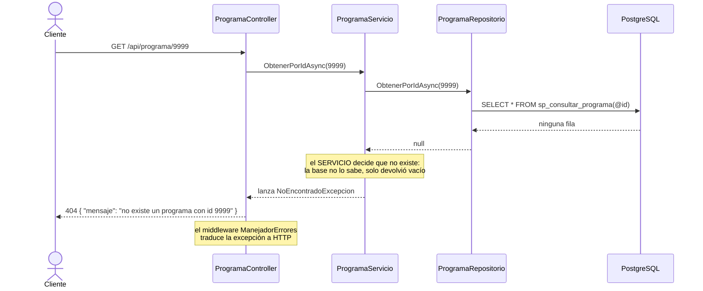
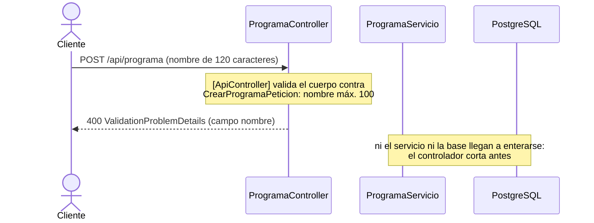
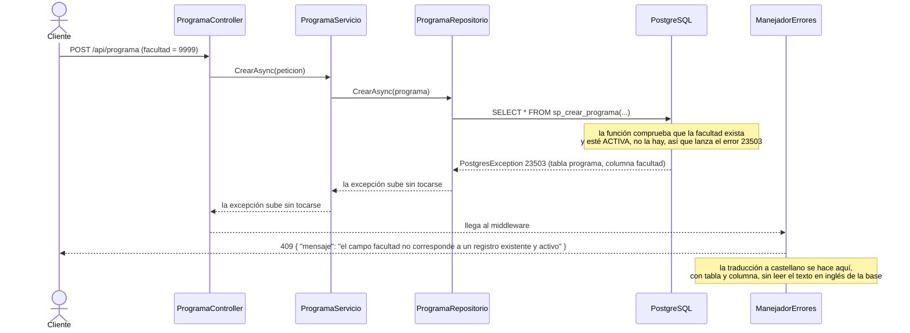

# 6_contracts.md — Versión 2: tablas con llave foránea

> Formato de errores y códigos según el Artículo 8 de la constitución. Solo
> `PUT` (sin `PATCH`, Artículo 7). Los nombres JSON van en `camelCase` y
> corresponden a las columnas de [5_data_model.md](5_data_model.md).

## Códigos de estado (iguales en las 22 tablas)

| Verbo | Éxito | Errores |
|---|---|---|
| `GET` lista | `200` arreglo (solo `activo: true`) | — |
| `GET` por llave | `200` el objeto | `404` no existe o está retirado |
| `POST` | `201` fila **como quedó guardada** + `Location` | `400` body inválido · `409` llave repetida / padre inexistente o retirado |
| `PUT` | `200` fila como quedó guardada | `400` · `404` · `409` (padre inexistente o retirado) |
| `DELETE` | `204` (marca `activo = false`) | `404` · `409` (maestro con detalle activo) |

Cualquier otro fallo de la base es `500`. **Un `500` donde correspondía un
`409` es criterio fallado** (criterio 7).

### Formato de los errores

| Caso | Código | Cuerpo |
|---|---|---|
| No existe | `404` | `{ "mensaje": "no existe un programa con id 9999" }` |
| Llave repetida | `409` | `{ "mensaje": "ya existe un programa con id 10101" }` |
| Llave repetida (la detecta la base) | `409` | `{ "mensaje": "ya existe un registro de programa con esa llave" }` |
| Padre inexistente o retirado | `409` | `{ "mensaje": "el campo facultad no corresponde a un registro existente y activo" }` |
| Pareja repetida (tabla puente) | `409` | `{ "mensaje": "la asignación ya existe" }` |
| Retiro de maestro con detalle activo | `409` | `{ "mensaje": "no se puede retirar el programa 10101: tiene registros activos" }` |
| Body inválido | `400` | `ValidationProblemDetails` estándar de ASP.NET Core |

## `programa` (documentado completo; representa a las 7 entidades con llave simple)

| Verbo y ruta | Body | Éxito | Errores |
|---|---|---|---|
| `GET /api/programa` | — | `200` `[{id, nombre, tipo, nivel, fechaCreacion, fechaCierre, numeroCohortes, cantGraduados, fechaActualizacion, ciudad, facultad, facultadNombre, activo}]` | — |
| `GET /api/programa/{id}` | — | `200` el objeto (con `facultadNombre`) | `404` |
| `POST /api/programa` | `{id, nombre, tipo, nivel, fechaCreacion, fechaCierre, numeroCohortes, cantGraduados, fechaActualizacion, ciudad, facultad}` | `201` objeto guardado, header `Location` | `400` · `409` |
| `PUT /api/programa/{id}` | igual, sin `id` | `200` objeto guardado | `400` · `404` · `409` |
| `DELETE /api/programa/{id}` | — | `204` | `404` · `409` (tiene detalle activo) |

`facultadNombre` solo aparece en las lecturas (viene del `JOIN` dentro del
`sp_listar_`/`sp_consultar_`); las respuestas de `POST` y `PUT` devuelven la fila
tal cual quedó guardada, sin ese campo. `fechaCierre` admite `null`.

### Maestro-detalle (lecturas y lote)

Un detalle no existe sin su maestro: se lee y se agrega **desde** el maestro.

| Verbo y ruta | Qué hace |
|---|---|
| `GET /api/programa/{id}/acreditaciones` | detalle activo del programa; igual para `registros_calificados`, `actividades_academicas`, `pasantias`, `premios` |
| `POST /api/programa/{id}/acreditaciones/lote` | agrega varios renglones **en un solo envío** (ver abajo); igual para los otros cuatro detalles |
| `GET /api/facultad/{id}/programas` · `POST /api/facultad/{id}/programas/lote` | detalle de `facultad` |
| `GET /api/universidad/{id}/facultades` · `POST /api/universidad/{id}/facultades/lote` | detalle de `universidad` |

En `actividades_academicas` el maestro se guarda en `disenio`.

**Cuerpo del lote** (el maestro viaja en la ruta, no en cada renglón):

```json
{
  "renglones": [
    { "resolucion": 5001, "tipo": "Alta calidad", "calificacion": "A", "fechaInicio": "2024", "fechaFin": "2028" },
    { "resolucion": 5002, "tipo": "Renovación", "calificacion": "A", "fechaInicio": "2028", "fechaFin": "2032" }
  ]
}
```

| Resultado | Código | Cuerpo |
|---|---|---|
| Todos guardados | `201` | arreglo con las filas como quedaron guardadas |
| Un renglón inválido (formato) | `400` | `ValidationProblemDetails`, con la clave del renglón (`renglones[1].tipo`) |
| Un renglón con llave repetida o padre inexistente | `409` | `{ "mensaje": "renglón 2: ya existe una acreditación con esa llave" }` y **no se guarda ninguno** |
| Maestro inexistente | `404` | `{ "mensaje": "no existe un programa con id 9999" }` |

Una función = una transacción: la base guarda **todos** o **ninguno**.

## Tablas puente solo de llaves (se asignan y se retiran; sin `PUT`)

Ejemplo `programa_ac` (representa a las 5): la pareja existe o no existe; no se edita.

| Verbo y ruta | Body | Éxito | Errores |
|---|---|---|---|
| `GET /api/programa_ac` | — | `200` `[{programa, programaNombre, areaConocimiento, areaConocimientoNombre, activo}]` | — |
| `GET /api/programa_ac/{programa}/{areaConocimiento}` | — | `200` la pareja | `404` |
| `POST /api/programa_ac` | `{programa, areaConocimiento}` | `201` pareja guardada, `Location` a la ruta anterior | `400` · `409` (pareja activa repetida, o programa/área inexistente o retirado) |
| `DELETE /api/programa_ac/{programa}/{areaConocimiento}` | — | `204` | `404` |

Si la pareja existe **retirada**, `POST` la **reactiva** y responde `201` (D-v2-7).

| Tabla | Ruta base | Llave compuesta en la ruta | Body del `POST` |
|---|---|---|---|
| `programa_ac` | `/api/programa_ac` | `{programa}/{areaConocimiento}` | `programa`, `areaConocimiento` |
| `programa_pe` | `/api/programa_pe` | `{programa}/{practicaEstrategia}` | `programa`, `practicaEstrategia` |
| `programa_ci` | `/api/programa_ci` | `{programa}/{carInnovacion}` | `programa`, `carInnovacion` |
| `an_programa` | `/api/an_programa` | `{aspectoNormativo}/{programa}` | `aspectoNormativo`, `programa` |
| `enfoque_rc` | `/api/enfoque_rc` | `{enfoque}/{registroCalificado}` | `enfoque`, `registroCalificado` |

## Tablas puente con campos propios (los 5 verbos)

Mismos códigos que `programa`, con la llave compuesta en la ruta. `PUT` actualiza
solo los campos propios.

| Tabla | Ruta base | Llave en la ruta | Campos propios (body del `PUT`) | Body del `POST` |
|---|---|---|---|---|
| `aa_rc` | `/api/aa_rc` | `{activAcademicasIdcurso}/{registroCalificadoCodigo}` | `componente`, `semestre` | las 2 llaves + `componente`, `semestre` |
| `docente_departamento` | `/api/docente_departamento` | `{docente}/{departamento}` | `dedicacion`, `modalidad`, `fechaIngreso`, `fechaSalida` (admite `null`) | las 2 llaves + los propios |
| `alianza` | `/api/alianza` | `{aliado}/{departamento}` | `fechaInicio`, `fechaFin` (admite `null`), `docente` (admite `null`) | las 2 llaves + los propios |

`docente` **no se valida** contra ninguna tabla (es de otro módulo). `departamento`
apunta a `programa`.

## Las otras 6 entidades con llave simple — mismo patrón que `programa`

| Tabla | Ruta base | Body (sin la llave) | Texto del padre en las lecturas |
|---|---|---|---|
| `facultad` | `/api/facultad` | `nombre`, `tipo`, `fechaFun` (`YYYY-MM-DD`), `universidad` | `universidadNombre`; también `totalProgramas` (solo lectura: lo escribe el disparador, cualquier valor enviado se ignora) |
| `acreditacion` | `/api/acreditacion` (llave `{resolucion}`) | `tipo`, `calificacion`, `fechaInicio`, `fechaFin`, `programa` | `programaNombre` |
| `registro_calificado` | `/api/registro_calificado` (llave `{codigo}`) | `cantCreditos`, `horaAcom`, `horaInd`, `metodologia`, `fechaInicio`, `fechaFin`, `duracionAnios`, `duracionSemestres`, `tipoTitulacion`, `programa` | `programaNombre` |
| `activ_academica` | `/api/activ_academica` | `nombre`, `numCreditos`, `tipo` (máx. 20), `areaFormacion`, `hAcom`, `hIndep`, `idioma`, `espejo` (0 o 1), `entidadEspejo`, `paisEspejo`, `disenio` (admite `null`) | `disenioNombre` (`null` si no hay) |
| `pasantia` | `/api/pasantia` | `nombre`, `pais`, `empresa`, `descripcion`, `programa` | `programaNombre` |
| `premio` | `/api/premio` | `nombre`, `descripcion`, `fecha`, `entidadOtorgante`, `pais`, `programa` | `programaNombre` |

Reglas de `activ_academica`: si `espejo = 0`, `entidadEspejo` y `paisEspejo` se
guardan como `"No aplica"` aunque no se envíen (D-v2-14); si `espejo = 1` son
obligatorios.

## Cambios a las 7 tablas de la v1 (regresión)

Las rutas y los cuerpos **no cambian**. Solo:

| Cambio | v1 | v2 |
|---|---|---|
| Llave repetida | `400` | **`409`** (Art. 3 y 8 enmendados) |
| `area_conocimiento.disciplina` | máx. 60 | máx. **130** |
| `programa.nombre` | (tabla nueva) | máx. **100** |
| Nuevas rutas | — | `GET /api/universidad/{id}/facultades` y `POST …/facultades/lote` |

## Secuencias de error

### El 404: quién decide que «no existe»



Se lee de arriba abajo. La base responde «sin filas»; la decisión de que eso es
un 404 es del servicio, y la traducción a HTTP es del manejador de errores.
Para un retirado pasa lo mismo: `sp_consultar_` filtra `activo`, así que también
llega vacío.

### El 400: dónde corta la validación del cuerpo



La validación de formato (obligatorio, longitud) vive solo en el controlador, con
los atributos de la petición. Si el cuerpo es inválido, ninguna otra capa se
ejecuta.

### El 409: la llave foránea inválida



Una llave foránea nativa (padre que no existe) y la comprobación de padre
retirado lanzan el **mismo** código `23503`, por eso el manejador responde 409
por un único camino. Ninguna capa intermedia captura la excepción.
