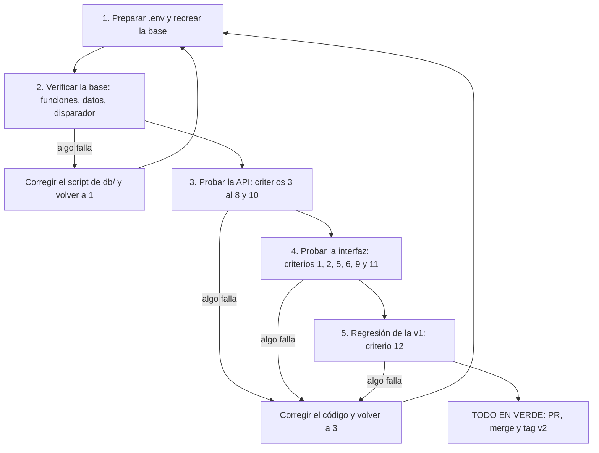

# 7_quickstart.md — Versión 2: levantar y comprobar

> Receta para arrancar la v2 desde cero y comprobar sus 12 criterios
> ([2_spec.md](2_spec.md)). Los comandos son de **PowerShell**, desde la carpeta
> que contiene `docker-compose.yml`. La versión se cierra solo cuando todo lo de
> aquí está en verde.

## El ciclo de validación



Se lee de arriba abajo. Cada paso es una compuerta: en rojo se corrige y se
vuelve al principio del paso que falló; solo con todo en verde se hace el tag.
La regresión de la v1 es obligatoria, no opcional.

## 1. Preparar

```powershell
Copy-Item .env.example .env        # y edita .env: pon tu propia DB_PASSWORD
docker compose down -v             # borra el volumen: la contraseña se fija al crearlo
docker compose up -d --build
docker compose ps                  # db, api y frontend deben estar "Up"
```

`.env.example` trae solo valores de mentira:

```
DB_USER=postgres
DB_PASSWORD=cambia_esta_clave
DB_NAME=innovacion_curricular
```

Espera **60 a 90 segundos** a que `dotnet watch` compile la API. Revisa con
`docker compose logs api` que diga que escucha en el puerto 8080.
Direcciones: API y Swagger `http://localhost:8080/swagger` · Frontend
`http://localhost:8081` · PostgreSQL `localhost:15432`.

## 2. Verificar la base

```powershell
$psql = "docker compose exec -T db psql -U postgres -d innovacion_curricular -t -A -c"
Invoke-Expression "$psql `"SELECT count(*) FROM pg_proc WHERE proname LIKE 'sp\_%'`""
Invoke-Expression "$psql `"SELECT (SELECT count(*) FROM area_conocimiento), (SELECT count(*) FROM universidad), (SELECT count(*) FROM facultad), (SELECT count(*) FROM programa)`""
Invoke-Expression "$psql `"SELECT sum(total_programas) FROM facultad`""
```

| Comprobación | Esperado |
|---|---|
| Funciones `sp_*` | **115**: 105 de CRUD (17 tablas con los 5 verbos y 5 puentes solo de llaves con 4) + 7 de lote + 3 de conteo |
| Datos de referencia | `218 · 6 · 35 · 191` (áreas, universidades, facultades, programas) |
| `sum(total_programas)` | `191`: el disparador contó solos los programas cargados |
| Restricciones | `\d programa` muestra `programa_facultad_fkey`; si algún nombre difiere, se corrige `5_data_model.md` |

## 3. Probar la API

Un ayudante que imprime solo el código de estado (los errores esperados no
detienen el script):

```powershell
function Probar($metodo, $ruta, $cuerpo = $null) {
  $p = @{ Method = $metodo; Uri = "http://localhost:8080$ruta"; UseBasicParsing = $true }
  if ($cuerpo) { $p.ContentType = 'application/json'
                 $p.Body = [Text.Encoding]::UTF8.GetBytes(($cuerpo | ConvertTo-Json -Depth 5)) }
  try   { "$((Invoke-WebRequest @p).StatusCode)  $metodo $ruta" }
  catch { "$($_.Exception.Response.StatusCode.value__)  $metodo $ruta" }
}
$prog = @{ id=99999; nombre='Programa de prueba'; tipo='Programa Académico'; nivel='Pregrado'
           fechaCreacion='2026'; fechaCierre=$null; numeroCohortes='1'; cantGraduados='0'
           fechaActualizacion='2026'; ciudad='Bogotá'; facultad=101 }
```

| # | Criterio | Petición | Esperado |
|---|---|---|---|
| 2 | Crear y leer | `Probar POST /api/programa $prog` y `Probar GET /api/programa/99999` | `201` y `200` |
| 7 | Padre inexistente | `$prog.id=99998; $prog.facultad=9999; Probar POST /api/programa $prog` | **`409`** (un `500` es fallo) |
| 7 | Llave repetida | repetir el primer `POST` (`$prog.id=99999; $prog.facultad=101`) | `409` |
| 6 | FK opcional vacía | crear una `activ_academica` con `disenio = $null` | `201` |
| 8 | Puente: asignar, repetir, retirar | `POST /api/programa_ac @{programa=10101; areaConocimiento=1}`; repetirlo; `DELETE /api/programa_ac/10101/1` | `201`, **`409`**, `204` |
| 8 | Puente: reactivar | volver a hacer el `POST` anterior | `201` |
| 10 | Retiro lógico | `Probar DELETE /api/programa/99999` y luego `GET /api/programa/99999` | `204` y `404` |
| 10 | …y sigue en la base | `SELECT id, activo FROM programa WHERE id = 99999` | una fila con `activo` en `f` (falso) |
| B1 | Maestro con detalle | `Probar DELETE /api/facultad/101` | `409` («tiene registros activos») |
| Lote | Todo o nada | `POST /api/programa/10101/acreditaciones/lote` con 2 renglones y el segundo con una `resolucion` repetida | `409` y **ninguno** guardado |
| 9 | Detalle de una universidad | `GET /api/universidad/{id}/facultades` con el id de la universidad a la que pertenece la facultad 101 | `200` y la lista incluye la facultad 101 |
| 3 | Sin SQL en C# | `Select-String -CaseSensitive -Path api_innovacion\Repositorios\*.cs -Pattern "SELECT\|INSERT\|UPDATE\|DELETE" \| Where-Object { $_.Line -notmatch "FROM sp_" }` | **sin resultados** |

**El disparador (criterio 4)** se prueba por la API y se lee en la base, sin que
el código envíe el total:

```powershell
Invoke-Expression "$psql `"SELECT total_programas FROM facultad WHERE id = 101`""   # anota N
Probar POST /api/programa $prog                                                       # 201
Invoke-Expression "$psql `"SELECT total_programas FROM facultad WHERE id = 101`""   # N + 1
Probar DELETE /api/programa/99999                                                     # 204 (retirar es un UPDATE)
Invoke-Expression "$psql `"SELECT total_programas FROM facultad WHERE id = 101`""   # otra vez N
```

Si al retirar el contador **no** baja, el disparador es sordo al `UPDATE`.
Además, mover un programa a otra facultad debe corregir **las dos** facultades
(D-v2-6).

## 4. Probar la interfaz (sin Swagger)

Abre `http://localhost:8081` y recorre:

| # | Criterio | Qué se hace | Esperado |
|---|---|---|---|
| 1, 2 | CRUD de las 22 tablas | por cada tabla: crear, editar, retirar | sin error; lo retirado desaparece de la lista |
| 5 | Desplegables | abrir «Nuevo programa» | el campo Facultad está **lleno de nombres**, no de códigos |
| 6 | «(ninguna)» | crear una actividad académica sin programa de diseño | se guarda, sin error de conversión |
| 8 | Puente | asignar y retirar un área a un programa; repetir la asignación | un mensaje claro, no un error técnico |
| 9 | Maestro-detalle | abrir un programa | ahí mismo están sus acreditaciones, pasantías, premios…; agregar 3 renglones y enviar |
| 11 | Sin jerga | leer todas las pantallas | no aparece «PUT», «PATCH», «422» ni «FK» |
| — | Desplegable sin retirados | retirar una facultad y abrir «Nuevo programa» | la facultad retirada ya no se ofrece |

## 5. Regresión de la v1 (criterio 12)

Se corren **completos** los criterios de `v1_catalogos_postgres/2_spec.md`, con
los tres cambios que registra `6_contracts.md`:

| Criterio de la v1 | Cambio en la regresión |
|---|---|
| Crear con un id existente | ahora **409**, no 400 |
| Campo que excede su longitud | usa el límite nuevo de `disciplina`: 130 (el de `programa.nombre`, 100, es de una tabla nueva y se prueba en §3) |
| Rutas nuevas del maestro (`GET /api/universidad/{id}/facultades` y su lote) | no existen en la v1, no hay criterio que cambiar; se prueban en §3 |
| El resto (crear → listar → editar → retirar; `activo = false` en la base) | igual |

## Todo de una vez

`pruebas/v2_pruebas.ps1` corre los criterios 1 al 12 (API, base e interfaz) y
la regresión de la v1 en una sola pasada y termina con `TODO EN VERDE`:

```powershell
powershell -ExecutionPolicy Bypass -File .\pruebas\v2_pruebas.ps1 | Tee-Object -FilePath .\pruebas\evidencia_v2.txt
```

Revisa solo con ojos humanos lo que un script no ve: que las pantallas se
entiendan (criterio 11) y que los mensajes de error estén en castellano claro.

## Cierre

Con todo en verde: pull request desde la rama de cada integrante, revisión y
merge **solo del encargado del main**, y entonces el tag:

```powershell
git checkout main
git pull
git tag v2
git push origin v2
```

El tag va sobre el commit que pasa los doce criterios, y la evidencia de este
quickstart (las salidas de arriba) se entrega junto a los enlaces de los dos
repositorios.
