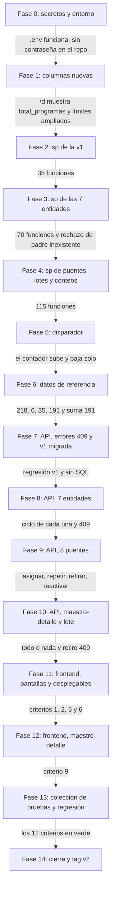

# 8_tasks.md — Versión 2: tablas con llave foránea

Cada fase termina con **un commit y un push** (requisito del profesor: un
commit por fase, push después del commit). No se avanza con la verificación de
la fase actual en rojo (Artículo 1). Las fases 0 a 6 son de la base y el
entorno; la API empieza en la 7, y la interfaz en la 11.

## El orden de las fases, con sus compuertas

Se lee de arriba abajo; el texto de cada flecha es la condición para pasar a la
siguiente fase. Una flecha que no se cumple devuelve a su fase.

## Las fases

| Fase | Tareas | Verificar |
|---|---|---|
| **0** — Secretos y entorno | `.env.example` · `.env` (no versionado) · `.gitignore` con `.env`, `bin/`, `obj/` y `frontend_innovacion/` · `docker-compose.yml` lee `${DB_PASSWORD}` y arma la cadena de conexión · nueva contraseña (rotación, D-v2-10) | `Select-String -Path docker-compose.yml -Pattern "Diseno123"` **sin resultados** · `git ls-files` solo lista `.env.example` · `docker compose down -v; docker compose up -d --build` levanta con la clave nueva |
| **1** — Columnas nuevas | `db/02_alter_v2.sql`: `facultad.total_programas`, `disciplina` a `VARCHAR(130)`, `programa.nombre` a `VARCHAR(100)` | `\d facultad` muestra `total_programas` · `\d area_conocimiento` muestra `character varying(130)` · `\d programa` muestra `(100)` |
| **2** — Funciones de la v1 | `db/03_sp_v1.sql`: los 5 `sp_*` de las 7 tablas | `SELECT count(*) FROM pg_proc WHERE proname LIKE 'sp_%'` = **35** · `SELECT * FROM sp_listar_universidad()` devuelve filas con `activo` |
| **3** — Funciones de las 7 entidades | `db/04_sp_v2.sql` (primera parte): `facultad`, `programa`, `acreditacion`, `registro_calificado`, `activ_academica`, `pasantia`, `premio`, con `RETURNING *`, `JOIN` del nombre del padre y comprobación de **padre activo** (D-v2-13) | total = **70** · `SELECT * FROM sp_crear_programa(...)` con `facultad = 9999` lanza `23503` en `psql` |
| **4** — Puentes, lotes y conteos | `db/04_sp_v2.sql` (segunda parte): 8 tablas puente (los 4 verbos o los 5), `sp_crear_<detalle>_lote` ×7 con `jsonb_to_recordset`, `sp_contar_detalle_*` ×3, reactivación de parejas (D-v2-7) | total = **115** · asignar, repetir y retirar una pareja en `psql`: la repetida da `23505`, la retirada se reactiva |
| **5** — Disparador | `db/05_disparadores.sql`: `fn_contar_programas` + `trg_contar_programas` (INSERT, UPDATE y DELETE; recalcula `OLD` y `NEW`) | en `psql`: insertar un programa sube el contador · `UPDATE ... SET activo = false` lo baja · mover un programa a otra facultad corrige **las dos** |
| **6** — Datos de referencia | `db/06_datos_referencia.sql` generado de `Base de Datos v6.xlsx` con las reglas de D-v2-12 (ids 1–218, relleno documentado, «Ciencias») | `218 · 6 · 35 · 191` · `SELECT sum(total_programas) FROM facultad` = **191** |
| **7** — API: errores y v1 migrada | `Middleware/ManejadorErrores.cs` · `ConflictoExcepcion` a 409 · los 7 repositorios de la v1 pasan a `SELECT * FROM sp_xxx(...)` · límites nuevos en `disciplina` y `programa.nombre` | regresión de la v1 (`7_quickstart.md` §5) en verde · la búsqueda de `SELECT/INSERT/UPDATE/DELETE` que no sean `FROM sp_` sin resultados |
| **8** — API: 7 entidades | por entidad: Modelo · Peticiones · Repositorio (interfaz + clase) · Servicio · Controller · registro en `Program.cs` | `dotnet build` sin errores · ciclo crear → listar → editar → retirar de cada una · `POST` con padre inexistente = **409** |
| **9** — API: 8 puentes | las mismas capas, con llave compuesta en la ruta; sin `PUT` en los 5 de solo llaves | asignar `201` · repetir **409** · retirar `204` · asignar de nuevo `201` (reactiva) |
| **10** — API: maestro-detalle y lote | rutas `GET …/{id}/{detalle}` y `POST …/lote` de `universidad`, `facultad` y `programa` · regla B1 en el servicio (`TieneDetalleActivoAsync`) | lote con un renglón repetido = **409 y ninguno guardado** · `DELETE /api/facultad/101` con programas activos = **409** |
| **11** — Frontend: pantallas y desplegables | 15 clientes HTTP · 15 modelos · páginas Index/Crear/Editar ×15 · `<select>` llenos desde la API (solo activos) · «(ninguna)» → `null` · menú | criterios **1, 2, 5 y 6** de `7_quickstart.md` §4: desplegable lleno de nombres, sin jerga |
| **12** — Frontend: maestro-detalle | `Detalle` de `universidad`, `facultad` y `programa`: ver el detalle y agregar varios renglones en un solo envío | criterio **9**: abrir un programa, agregar 3 acreditaciones y ver que viajan en **una** petición |
| **13** — Colección de pruebas y regresión | `pruebas/v2_pruebas.ps1` con las peticiones de `7_quickstart.md` §3 (incluidas las que deben fallar) · correr la regresión de la v1 | el script termina con todos los códigos esperados · los 12 criterios en verde |
| **14** — Cierre | `GUIA_IA2.md` (prompts reales y lo que hubo que corregirle a la IA) · `9_checklist.md` firmado · `README.md` · `0_mapa_versiones.md` (v2 cerrada) · pull request de cada rama, merge del encargado, tag `v2` en **los dos repos** | repos privados con el profesor invitado · tag `v2` sobre el commit que pasa los 12 criterios |

## Reglas operativas

| | |
|---|---|
| **Recrear la base** | PostgreSQL ejecuta `db/*.sql` solo al **crear** el volumen. Un cambio de tablas o columnas (fases 0, 1 y 6) pide `docker compose down -v` y `up`. Las funciones (fases 2 a 5) usan `CREATE OR REPLACE`, así que se pueden volver a aplicar sin recrear: `Get-Content db\04_sp_v2.sql \| docker compose exec -T db psql -U postgres -d innovacion_curricular` |
| **Un commit por fase** | Mensaje descriptivo en español, `git push` justo después. Nada de un solo commit gigante la noche anterior |
| **Dos repositorios** | Las fases 11 y 12 se commitean en el repo del frontend, cada una en su rama; el tag `v2` va en **ambos** |
| **Nada se anticipa** | Ni sesión, ni roles, ni consultas multitabla (Artículo 1) |

## Reparto entre integrantes

La sustentación individual evalúa **los commits de cada integrante** («una rama
sin commits es una sustentación sin evidencia», `0_METODOLOGIA.md` §2.1). Se
propone repartir por bloques que no se pisen, para que los dos tengan trabajo
propio y explicable:

| Bloque | Fases | Archivos principales |
|---|---|---|
| **A: base de datos** | 0 a 6 | `db/*.sql`, `.env.example`, `docker-compose.yml` |
| **B: API** | 7 a 10 | `api_innovacion/**` |
| **C: frontend y cierre** | 11 a 14 | `frontend_innovacion/**`, `pruebas/`, `GUIA_IA2.md` |

Quién toma cada bloque se acuerda en el equipo y se escribe aquí antes de
empezar. Cada uno debe poder explicar en voz alta cualquier archivo de **su**
bloque (qué hace, por qué así, qué pasa si falla y qué cambiaría).

## Estado

Fases 0 a 14: pendientes. Se actualiza esta tabla al cerrar cada una.
