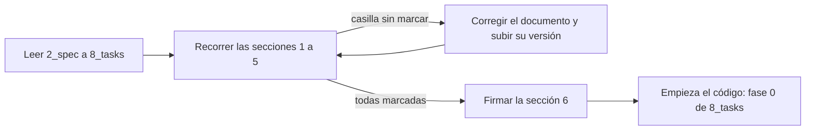

# 9_checklist.md — Versión 2: lista de requisitos (compuerta 3)

> Control de calidad sobre la **especificación**, no sobre el código. Se pasa
> antes de escribir una línea de la v2. Las casillas las marca **una persona**
> que haya leído los documentos 2 a 8; una casilla marcada sin leer no vale.
> Con una casilla en rojo, la spec se corrige y **no se escribe código**.

## 1. ¿Cada criterio es medible?

Cada fila debe poder responderse con un número, un código HTTP o un texto
exacto. La columna final dice dónde está esa comprobación.

| ☐ | Requisito o criterio | Cómo se mide | Dónde se comprueba |
|---|---|---|---|
| ☐ | RF1 / criterio 3 | 115 funciones `sp_*`; la búsqueda de `SELECT/INSERT/UPDATE/DELETE` sin `FROM sp_` en los repositorios no da resultados | `7_quickstart.md` §2 y §3 |
| ☐ | RF2 / criterio 10 | `DELETE` → 204; `GET` → 404; la base conserva la fila con `activo = f` | §3 |
| ☐ | RF3 | la respuesta de `POST` trae los valores por defecto y el contador calculado | `6_contracts.md` |
| ☐ | RF4 / criterio 7 | `POST` con padre inexistente o retirado → **409** con el nombre del campo; un 500 es fallo | §3 |
| ☐ | RF5 | pareja activa repetida → 409; pareja retirada → 201 | §3 |
| ☐ | RF6 / criterio 8 | asignar 201, repetir 409, retirar 204; los 5 puentes de solo llaves no tienen `PUT` | §3 |
| ☐ | RF7 y criterio 9 | desde un programa se ven y se agregan sus detalles sin salir | §4 |
| ☐ | RF8 | un lote con un renglón repetido → 409 y **ninguno** guardado | §3 |
| ☐ | RF9 / criterios 5 y 6 | el `<select>` muestra nombres, no ofrece retirados, y «(ninguna)» envía `null` | §4 |
| ☐ | RF10 / criterio 4 | insertar, retirar y mover un programa de facultad cambian `total_programas` sin que la API lo envíe | §3 |
| ☐ | RF11 / criterio 11 | no aparecen las palabras «PUT», «PATCH», «422» ni «FK» en ninguna pantalla | §4 |
| ☐ | RF12 | `DELETE` de una facultad con programas activos → 409 «tiene registros activos» | §3 |
| ☐ | RF13 | `Select-String` de la contraseña vieja en `docker-compose.yml` sin resultados; `.env` fuera de `git ls-files` | `8_tasks.md` fase 0 |
| ☐ | Criterios 1, 2 y 12 | las 22 tablas con crear, editar y retirar; regresión de la v1 completa | §4 y §5 |

## 2. ¿Cada requisito es único y no se contradice con otro?

- ☐ Ninguna fila de la sección 1 necesita un «y» para explicarse, salvo RF7 y RF9, que se comprueban por separado en la columna final.
- ☐ RF1 y RF6 no se contradicen: RF1 cuenta 4 verbos en los 5 puentes de solo llaves y 5 en las otras 17 tablas (105 funciones de CRUD).
- ☐ RF5 y B6 no se contradicen: la pareja **activa** repetida da 409; la **retirada** se reactiva.
- ☐ RF12 (B1) y RF2 no se contradicen: retirar un maestro con detalle activo es 409; retirar uno sin detalle activo es 204.
- ☐ Los 409 de `6_contracts.md` son los mismos de `2_spec.md` (padre, pareja, retiro de maestro, lote) y no hay un 400 ni un 500 en su lugar.
- ☐ Los conteos coinciden en los cinco documentos: 22 tablas, 15 nuevas, 115 funciones, 7 lotes, 3 conteos, datos `218 · 6 · 35 · 191`.

## 3. ¿Hay palabras vagas sin definir?

- ☐ Se buscaron «rápido», «amigable», «eficiente», «adecuado» y «claro» en los documentos 2 a 8: o no aparecen o tienen una definición medible al lado.
- ☐ «Sin jerga» tiene su lista cerrada de palabras (RF11).
- ☐ «Mensaje en castellano» tiene su formato en `6_contracts.md`, con ejemplos exactos.
- ☐ «Comentarios que dicen **por qué**» (RF14) no se puede medir con un comando. Se acepta como **revisión humana**: en cada pull request, quien revisa lee los comentarios y rechaza el que repite el nombre del método.

## 4. ¿Cada criterio se puede verificar con un comando o un recorrido?

- ☐ Los criterios 3, 4, 7, 8, 10 y 12 tienen un comando o una petición escrita en `7_quickstart.md`.
- ☐ Los criterios 1, 2, 5, 6, 9 y 11 son recorridos en la interfaz, con lo esperado escrito por pantalla.
- ☐ Cada fase de `8_tasks.md` termina en una condición que se puede comprobar, no en «revisar que funcione».
- ☐ La regresión de la v1 lista los tres cambios (409, límites 130 y 100, rutas nuevas) y nada más.

## 5. ¿Los documentos dicen lo mismo entre sí?

- ☐ `5_data_model.md`: los nombres de restricciones y columnas que usa `6_contracts.md` existen en el modelo.
- ☐ `3_plan.md`: la estructura de carpetas incluye todo lo que `8_tasks.md` manda crear.
- ☐ `4_research.md`: cada decisión D-v2-N está aplicada en el plan o el modelo, y ninguna quedó huérfana.
- ☐ `1_constitution.md`: los artículos enmendados (1, 2, 3, 6 y 8) dicen lo mismo que el plan.
- ☐ `0_mapa_versiones.md`: la v2 figura «En curso» con las mismas 15 tablas.

## Hallazgos de la primera pasada

La revisión de redacción (hecha con ayuda de IA) encontró dos contradicciones,
ya corregidas en `2_spec.md` v2.4. Las casillas de las secciones 2 y 5 las marca
la persona que revisa, no esta nota.

| Hallazgo | Corrección |
|---|---|
| RF1 y el criterio 3 decían «5 verbos de las 22 tablas», pero los 5 puentes de solo llaves no se editan (RF6): son 4 verbos | RF1 y criterio 3 cuentan 4 y 5 verbos y apuntan a las 115 funciones |
| RF5 decía 409 para toda pareja repetida, pero B6 decide reactivar la retirada | RF5 distingue pareja **activa** (409) de **retirada** (201) |
| La spec nombra `sp_*` y `activo`, que son tecnología | Se mantiene: `VERSION_2.md` los exige como requisito del profesor, no como decisión nuestra |

## 6. Firma

| Persona | Documentos revisados | Fecha | Firma |
|---|---|---|---|
| | | | |
| | | | |

Con las dos firmas y todas las casillas marcadas, la compuerta 3 queda cerrada y
empieza la fase 0 de `8_tasks.md`.
