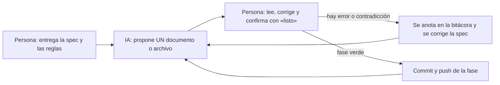

# GUIA_IA2.md — Cómo se construyó la versión 2 con ayuda de IA

> Dos partes: (1) la receta para reconstruir la v2 con una IA (chat o IDE
> agéntico), y (2) la bitácora **real** de este equipo: qué se le pidió a la IA
> y, sobre todo, **qué hubo que corregirle**. La IA propone, las personas
> verifican y firman; la regla de la v1 sigue igual: la IA no inventa, **sigue
> el spec kit**.



## Parte 1. Receta para reconstruir la v2

### 1.1 Qué se le entrega a la IA

| Qué | Dónde |
|---|---|
| Los 8 documentos | `1_constitution.md` y, de `versiones/v2_tablas_con_fk/`, del `2_spec.md` al `8_tasks.md` |
| El mapa | `versiones/0_mapa_versiones.md` |
| La base dada por el profesor | `db/00_innovacion_curricular.pg.sql` |
| Los datos de referencia | `Base de Datos v6.xlsx` (para la fase 6) |
| El código de la v1 | el proyecto con el tag `v1`: la v2 lo **migra**, no parte de cero |

**No se le entrega** `9_checklist.md`: revisa la spec, no la describe.

### 1.2 El prompt (cópielo tal cual como primer mensaje)

```
Actúa como mi asistente de programación para construir la VERSIÓN 2 de un
proyecto universitario que YA tiene la versión 1 funcionando (tag v1). Te
adjunto la constitución, el mapa de versiones y los 7 documentos de la v2
(spec, plan, research, modelo de datos, contratos, quickstart y tareas), más
el script de la base de datos y el código de la v1.

El proyecto es C# sobre ASP.NET Core (.NET 10) + Dapper + Npgsql + PostgreSQL
16 + Razor Pages, como fija 3_plan.md. Si tu respuesta usa OTRO lenguaje o
framework, no leíste los adjuntos: detente y dímelo.

REGLAS (no negociables):

1. La especificación manda. No agregues NADA que los documentos no pidan: ni
   paquetes extra, ni Entity Framework, ni PATCH, ni login, ni consultas
   multitabla. Si crees que falta algo, pregúntame antes.
2. Se sigue 8_tasks.md FASE POR FASE. En cada fase: (a) 3 a 5 líneas de qué se
   hace y por qué; (b) UN archivo a la vez, con su ruta y su contenido completo,
   y esperas mi «listo»; (c) al cerrar, el comando de verificación y la salida
   que debo ver. No avances con una verificación en rojo.
3. TODO el SQL vive en db/ como funciones sp_*. En C# la única sentencia
   permitida es SELECT * FROM sp_xxx(@p1, …) como texto, nunca CommandType.
   StoredProcedure (con Npgsql 7 o más se convierte en CALL y falla con
   funciones).
4. Los errores de la base se traducen por SqlState (23503 y 23505) a 409 con
   mensaje en castellano que nombra el campo. Nunca un 500 por llave foránea ni
   por duplicado.
5. Cumple 6_contracts.md al pie de la letra: rutas, verbos, códigos y formatos.
6. Los comentarios dicen POR QUÉ, no qué. El que repite el nombre del método no
   sirve.
7. Los secretos van en .env (fuera de git) y .env.example con valores de
   mentira. Ninguna contraseña en el código ni en el compose.
8. Windows, PowerShell, Docker Desktop. Puertos: BD 15432, API 8080, frontend
   8081. Trabajo en la rama cesar-dev, un commit por fase y push al terminar
   cada fase. Nunca en main.

La v2 está TERMINADA solo cuando pasan los 12 criterios de 2_spec.md con el
quickstart de 7_quickstart.md, corrido por mí.

Empieza: resume en máximo 10 líneas qué vamos a construir y arranca con la
Fase 0.
```

### 1.3 Cómo se supervisa

- **De a un archivo.** Si la IA entrega varios de un tirón, se le recuerda la regla 2.
- **Se pide evidencia, no «terminado».** La salida real de cada comando de verificación va en el commit o en el chat.
- **Se lee antes de pegar.** Cada persona debe poder explicar en voz alta su bloque de `8_tasks.md`: qué hace, por qué así, qué pasa si falla y qué cambiaría.
- **Si la IA contradice un documento,** gana el documento. Si el documento está mal, se corrige el documento (y se sube su versión) antes de tocar el código.

## Parte 2. Bitácora real del equipo

### 2.1 Instrucciones de dirección dadas a la IA (fase de especificación)

Las instrucciones se resumen y se redactan de forma académica; no son citas
textuales de la conversación. Cada una registra el objetivo, la instrucción y
el resultado verificable.

| # | Objetivo | Instrucción dada a la IA | Resultado |
|---|---|---|---|
| 1 | Evitar que la v2 se especificara por inercia de la v1 | No suponer el alcance: esperar el enunciado oficial de la segunda entrega | Se descartó un borrador y se esperó `VERSION_2.md` |
| 2 | Anclar la spec al enunciado del profesor | Derivar `2_spec.md` de `VERSION_2.md` | Spec con 12 criterios, 14 requisitos funcionales y la v1 incluida en el alcance |
| 3 | Cumplir la metodología | Aplicar `0_METODOLOGIA.md` a los documentos: diagramas, clarificaciones, secretos, comentarios | Cada documento con su diagrama Mermaid validado y una sección de clarificaciones |
| 4 | Decidir con criterio las clarificaciones B1 a B7 | Presentar las opciones de cada una con su consecuencia y una recomendación razonada | Siete decisiones registradas y firmadas por el equipo en `2_spec.md` |
| 5 | Comprender antes de decidir | Explicar el alcance de la v2, las funciones almacenadas y el disparador | Decisiones D-v2-1 a D-v2-14 de `4_research.md`, fundadas en lo explicado |
| 6 | Hacer verificable la entrega | Elaborar un procedimiento de prueba de extremo a extremo | `7_quickstart.md` con comandos y resultados esperados por criterio |
| 7 | Alinear el mapa de versiones con el ejemplo del curso | Reestructurar `0_mapa_versiones.md` según la estructura del profesor | Mapa con ruta de versiones, estado, reparto de las 25 tablas y registro de cambios |
| 8 | Resolver la ausencia de los datos de referencia | Localizar la fuente y proponer opciones con su costo | Fuente hallada (`Base de Datos v6.xlsx`); decisión de ampliar dos columnas y documentar los valores de relleno |

### 2.2 Lo que hubo que corregirle a la IA

| # | Qué hizo mal la IA | Cómo se detectó | Corrección |
|---|---|---|---|
| 1 | Primer borrador de `2_spec.md`: validaba llaves foráneas con 400, no usaba procedimientos y excluía modificar la v1 | Se contrastó con `VERSION_2.md` | Se descartó y se reescribió: 409, `sp_*` en todas las tablas y v1 migrada |
| 2 | `3_plan.md` decía llamar con `CommandType.StoredProcedure` | Se verificó en las notas de versión de Npgsql: desde la 7 genera `CALL`, que no sirve para funciones | Llamada como texto `SELECT * FROM sp_xxx(@p)`; corregidos plan, spec (criterio 3) y constitución (Art. 2) |
| 3 | Dijo que el Art. 7 de la constitución necesitaba enmienda | Se releyó el artículo | Solo necesitaba una precisión; las enmiendas son 1, 2, 3, 6 y 8 |
| 4 | Afirmó que el Excel de datos no venía en el zip | El equipo no lo recordaba y se buscó | Estaba como `Base de Datos v6.xlsx`; se reescribió D-v2-12 |
| 5 | Diagramas Mermaid con `PK_FK` y con punto y coma dentro de notas | `mmdc` falló al compilar | `PK, FK` y comas; **todos** los diagramas se validan con `mmdc` antes de entregarse |
| 6 | Un commit omitió `1_constitution.md` | Se vio en `git status` | Commit aparte (08c1bf5); desde entonces se usan rutas explícitas en `git add` |
| 7 | La spec decía a la vez «5 verbos en las 22 tablas» y «los puentes no se editan», y «toda pareja repetida da 409» y «la retirada se reactiva» | Compuerta 3 (`9_checklist.md`) | `2_spec.md` v2.4: 4 verbos en los 5 puentes de solo llaves; 409 solo para pareja **activa** |
| 8 | La rama `cesar-dev` no compartía historia con `main` (copia vieja) | `merge-base` vacío | Se realineó con `checkout -B` y `push --force-with-lease`; copia de seguridad en `respaldo-cesar-dev` |

Lo que enseñan las ocho filas: casi todos los errores se atraparon **contra un
documento o un comando** (el enunciado, las notas de versión, `mmdc`, la
compuerta 3), no por apreciación subjetiva. Esa es la razón de ser del método.

### 2.3 Fase de código

Se llena al cerrar cada fase de `8_tasks.md`, con lo que realmente pasó. Una
fila sin corrección dice «sin correcciones»; no se inventan.

| Fase | Prompt usado | Qué hubo que corregir | Evidencia (salida del «Verificar:») |
|---|---|---|---|
| 0 a 2 | «Haz la fase N de `8_tasks.md`» (un script por fase) | No se registró corrección | Commits `e5c076f`, `d562e09`, `32780d0`; las funciones cuentan lo esperado |
| 3 | Fase 3: funciones de las 7 entidades | Al aplicar se comprobó que el archivo ya estaba en `db/` con extensión `.txt` (se renombró) | Total de funciones y error `23503` al crear un hijo con padre inexistente |
| 4 | Fase 4: puentes, lotes y conteos | Los mensajes con tildes se dañaron al pasar el SQL por la tubería de PowerShell; se reaplicó copiando el archivo al contenedor y corriendo `psql -f` | 115 funciones; commit `4e890c5` |
| 5 | Fase 5: disparador | Sin correcciones | Contador 0/0, 2/0, 1/1, 0/1 al agregar, mover y retirar; commit `26b9772` |
| 6 | Fase 6: datos de referencia | Un `git push` falló por falta de internet y se repitió; la contraseña de la base que se había dado era otra (`.env` fija la del volumen al crearlo) | Áreas 218, universidades 6, facultades 35, programas 191, suma de `total_programas` 191; commit `c132610` |
| 7 | Fase 7: API de la v1 sobre funciones | Un comentario `// 409` quedó antes de `}` en una línea de 6 controladores (18 errores de compilación); además la primera prueba corrió contra el binario anterior porque `dotnet watch` no había aplicado el cambio | Regresión de la v1: 200, 201, 409, 204, 404 con mensaje; commit `1784f6a` |
| 8 | Fase 8: API de las 7 entidades | La IA olvidó la regla del espejo (D-v2-14); se corrigió en la fase 9. El 400 de la primera prueba era de PowerShell 5 (acentos sin enviar como UTF-8), no de la API | Ciclo de `programa`: 409, 200, 204, 404 y 409 con mensaje para una facultad inexistente; commit `afa225d` |
| 9 | Fase 9: API de las 8 tablas puente | Se agregó la regla del espejo omitida (rango 0 a 1; si es 0 se guarda «No aplica», si es 1 entidad y país son obligatorios) | Puente: 201, 409, 200, 204, 404, 201; espejo: 201 con «No aplica»; commit `7e00b2e` |
| 10 | Fase 10: maestro-detalle, lotes y regla de retiro | Llaves `{{ }}` duplicadas en el código generado de los repositorios (errores de compilación que la revisión de sintaxis no vio); se corrigió el generador y se añadió una verificación | Lote con error: 409 y ninguna fila guardada; lote bueno: 201; retiro con detalle: 409 con mensaje |
| 11 | Fase 11: frontend de las 22 tablas | Sin correcciones de código: compiló con 0 errores | Páginas de las 22 tablas con desplegables de nombres, «(ninguna)» y mensajes de la API |
| 12 | Fase 12: páginas de detalle con varias filas | Un conflicto de nombres entre el espacio de nombres de las páginas y los modelos se detectó antes de entregar (se calificaron los tipos); el parche de la página de Universidad se aplicó dos veces y dejó `MensajeError` duplicado (error CS0102), corregido a mano | Tres programas guardados de una vez; con una fila repetida no se guarda ninguna |
| 13 | Fase 13: colección de pruebas y regresión | El chequeo del criterio 3 daba falsos positivos porque `Select-String` no distingue mayúsculas y tomaba `.Select(` de LINQ por SQL; se hizo sensible a mayúsculas (y se corrigió el `7_quickstart.md`) | `pruebas/evidencia_v2.txt`: 189 correctas, 0 con falla |
| 14 | Cierre | pendiente | pendiente |

## Anotaciones para la sustentación

- **Qué decidió la IA y qué decidió el equipo:** las decisiones B1 a B7 las tomó el equipo (con orientación de la IA en B1); la IA no resolvió ninguna clarificación sola.
- **Qué no se delegó:** la firma del `9_checklist.md`, el `git tag v2` y el merge, que hace la persona encargada del main.
- **Qué se haría distinto:** se anota al cerrar la versión.
